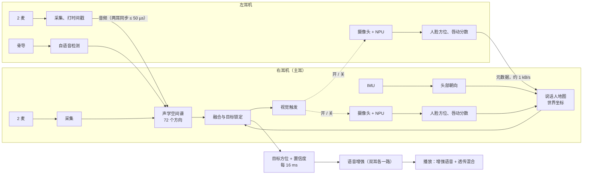

# 耳机声源定位技术方案 v0：无障碍听觉辅助

> 版本 v0.4，2026-11-18。用于内部讨论，11 月底定稿为 v1（连同算法选型）。v0.3：mentor 确认以《技术洞察》为准；按最小验证（`最小验证_刚性球模型.md`）定为两耳组阵。v0.4：按算法选型（`算法选型.md`）定为 GEVD-MUSIC + 软融合。
> **依据层级**：① mentor 的聊天要求与《耳机摄像头技术洞察：无障碍听觉辅助》PPT（`资料/耳机摄像头技术洞察_无障碍听觉辅助.md`，下称《技术洞察》）是主要依据；② mentor 此前发过的其他材料（《看哪听哪》、两份设计说明、Apple 专利分析）只作参考，其中的数字未经 mentor 确认用于本项目，引用处标【参考】；③ 与《技术洞察》写法不同的设计标【提议，待对齐】，汇总在第 14 节。
> 标注：**【事实】** 有出处；**【估算】** 按公式或假设计算；**【判断】** 设计选择，需仿真验证；**【待核实】** 尚未查证。未标注的是方案本身的设计。

## 1. 目标与范围

**目标**：用户戴着带摄像头的耳机与他人交谈时，耳机持续给出"目标说话人"的方向和置信度，供语音增强使用，帮助用户在嘈杂环境中听清对方。

**主次**：耳机声源定位是主体，逐帧运行；摄像头的人脸检测和唇动检测是辅助，按需运行，用来消除歧义、确认是谁在说话。

**本期边界**

| 项目 | 本期（v0–v1，12 月仿真） | 之后 |
|---|---|---|
| 说话人 | 位置固定 | 说话人移动时的动态定位与持续跟踪（第 10 节） |
| 定位维度 | 水平方位角 | 仰角、距离 |
| 我们负责 | 声源定位算法，以及它与视觉、增强之间的接口 | — |
| 由他人负责、本方案只定接口 | 人脸检测、唇动检测（视觉同事）；语音增强与播放 | — |
| 运行位置 | 全部端侧、离线，不依赖手机和云端 | — |
| 精度要求 | 【参考】相邻两人通常只隔 20–30°（《看哪听哪》第 3 页），目标方位误差应 ≤ 10°，争取 ≤ 5°，否则会锁到旁边的人 | — |

## 2. 场景设定（D9）

| 项目 | 设定 |
|---|---|
| 用户 | 坐着或站着交谈，头部自然转动（看向不同的人、偶尔环顾） |
| 目标说话人 | 1 人，距离 1–2 m，位于用户前方 ±60° 内 |
| 干扰说话人 | 2–4 人，分布在 360° 范围，距离 1–4 m |
| 背景噪声 | 餐厅 / 咖啡馆的嘈杂人声与餐具声，信噪比 0–10 dB |
| 混响 | RT60 0.3–0.8 s |
| 佩戴者自己说话 | 会有，必须排除，不能把自己定位成目标 |

## 3. 硬件假设（D2、D4）

耳机实际形态尚未确定。12 月做的是仿真，硬件按假设参数化：方案不依赖某一种具体形态，麦克风数、摄像头朝向都作为仿真变量比较，形态确定后替换参数即可。《技术洞察》第 2、6 页给出的组成：每耳 2–3 颗麦克风、左右耳联合组阵、前向 / 侧向摄像头、IMU、DSP / NPU 端侧算力；具体形态【待确认】。下表在这个范围内取一个基准值。

| 部件 | 每只耳机 | 说明 |
|---|---|---|
| 麦克风 | 2 个，耳柄上前后排列，间距约 1.5 cm | 常见 TWS 配置【判断】；每耳 3 麦作为对比项 |
| 骨导 / VPU | 1 个 | 判断佩戴者自己是否在说话 |
| IMU | 6 轴（陀螺仪 + 加速度计） | 头部转动角度 |
| 摄像头 | 1 个，水平视场约 100°，朝前（偏外 0–40°，仿真变量） | 交谈对象多在正前方，需要前向覆盖。偏外约 40° 时两只耳机的视场在正前方约 ±10° 重叠，同时兼顾侧方（`资料/binaural_visual_localization_design.md` 布局 B）；完全朝前时正前方覆盖最好（布局 D） |
| 视觉处理单元 | 低功耗 NPU（《技术洞察》第 6 页） | 只输出检测结果，不输出图像；【参考】《看哪听哪》中人脸检测为 SCRFD-0.5GF / UltraFace 级（0.3–0.6 M 参数） |
| 主处理芯片 | 耳机主芯片：音频 DSP + 小核 + 大核 | 声源定位与融合在 DSP；《技术洞察》第 6 页：经典信号处理在现有耳机 ANC 芯片量级基本够用。【参考】《看哪听哪》估计定位模块 < 0.1 M 参数、跑音频 DSP |

**坐标系**：以头部中心为原点，x 指向正前方、y 指向左方，方位角 θ 从正前方起逆时针为正（左为正）。两耳麦克风约在 y = ±9 cm 处。摄像头和麦克风相对头部的位置按固定外参处理（佩戴偏差作为仿真扰动项）。

## 4. 整体架构（D1）

| 模块 | 运行在 | 输入 | 输出 | 更新频率 |
|---|---|---|---|---|
| 采集与耳间传输 | 每只耳机 | 本耳 2 麦 | 副耳音频传到主耳，两耳采样同步误差 ≤ 50 µs | 连续 |
| 自语音检测 | 每只耳机 | 骨导信号 | 佩戴者是否在说话 | 每 16 ms |
| 声学空间谱 | 主耳音频 DSP | 两耳 4 路音频 | 72 个方向（5° 间隔）的似然、语音活动 | 每 16 ms |
| 人脸与唇动检测 | 低功耗 NPU | 图像 | 每张人脸的方位、唇动分数、置信度、时间戳 | 10–15 fps（《技术洞察》）；【提议，待对齐】平时降到 1–2 fps |
| 说话人地图 | 主耳 | 视觉结果、IMU、声学空间谱 | 世界坐标下每个人的方位、是否在说话 | 有新结果时 |
| 融合与目标锁定 | 主耳 | 声学空间谱、说话人地图、IMU | 目标方位（头部坐标）、置信度 | 每 16 ms |
| 视觉触发 | 主耳 | 融合状态 | 开 / 关哪只耳机的摄像头 | 事件触发 |

## 5. 输入：信号怎么进耳机

### 5.1 音频

- 每只耳机本地采集 2 麦，16 kHz、16 bit；帧长 32 ms（512 点），帧移 16 ms。
- 两耳组阵：副耳的音频传到主耳，4 麦联合测向（见 5.2）。

### 5.2 两耳之间传什么（D3）

《技术洞察》第 6 页的思路是**左右耳联合组阵**：基线约一个头宽才有足够分辨率，左右耳间的无线同步精度是难点。v0 曾提出一条不需要同步的备选路线 B（只传参数）。11-18 最小验证显示 B 在噪声和混响下远不如 A（嘈杂条件 ≤10° 的比例 37% vs 86%，仿真），**定为路线 A**；同步误差需控制在约 50 µs 以内（16 kHz 下不到 1 个采样点），超过 100 µs 精度崩溃（仿真，见 `最小验证_刚性球模型.md`）。

| 路线 | 传什么 | 链路负担 | 能用的方向线索 | 难点 / 特点 |
|---|---|---|---|---|
| A 双耳组阵（《技术洞察》的思路） | 一侧的音频传到另一侧，组成跨耳阵列 | 原始音频约 256 kbps / 路【估算】，持续传输；【参考】《看哪听哪》提到左右耳蓝牙只能传单通道 | 耳间时间差（左右最准）+ 每耳本地相位差 | 两耳采样要同步到微秒级：正前方附近每 1° 只对应约 9 µs 时间差【估算：头半径 8.75 cm、声速 343 m/s】；持续传音频功耗高 |
| B 只传参数（提议） | 各频带能量 + 本地估计结果 | 约 1 kB/s【估算】 | 耳间电平差（左右）+ 每耳前后相位差（前后） | 不需要采样同步，链路负担低；精度能否够用需仿真验证 |
| C 传低码率特征 | 跨耳相位差等 | 中等 | 耳间时间差 | A、B 之间的折中，同样需要同步【待核实】 |

**路线 B 的原设想（已被最小验证否定，保留作记录）**：两类线索在几何上互补。

- **每只耳机本地的前后两麦**沿前后方向排列，测出的是声源在"前后轴"上的投影（约等于 cos θ）：能分清前和后，但分不清左和右。
- **两耳之间的电平差**来自头部遮挡，反映声源在"左右轴"上的投影（约等于 sin θ）：能分清左和右，但分不清前和后。
- 两者合起来，方位角就唯一了。前后镜像这个耳机测向的老问题，在这个结构里由本地前后两麦直接给出答案；视觉再作为确认。

### 5.3 视觉结果（D5）

摄像头模组只输出检测结果，每张人脸一条：

| 字段 | 含义 |
|---|---|
| `t_exp` | 曝光时刻（与音频同一时钟） |
| `cam` | 左 / 右摄像头 |
| `face_id` | 跨帧的人脸编号 |
| `az`、`el` | 人脸中心在头部坐标下的方位角、仰角（模组内按外参换算） |
| `size` | 人脸框大小（粗估距离） |
| `lip` | 唇动分数 0–1 |
| `conf` | 检测置信度 |

按最多 5 张人脸、15 fps、每条约 16 字节估算，约 1.2 kB/s【估算】；平时 1–2 fps 时更少。视觉同事的实际输出格式确定后再对齐。

### 5.4 IMU 与时间同步

- IMU 200 Hz，主耳积分得到头部偏航角（yaw）。陀螺仪漂移靠视觉重新检测到同一个人时校正。
- 音频帧、IMU、视觉结果都打同一时钟的时间戳。说话人固定时，视觉结果按曝光时刻的头部朝向换算到世界坐标，因此**视觉的处理时延（几十毫秒）基本不影响精度**。

## 6. 声学定位怎么做（只定框架，具体算法见第 11 节）

1. **自语音排除**：骨导判断佩戴者在说话时，这些帧不参与定位。
2. **语音活动检测**：只在有语音的帧更新空间谱。
3. **两耳组阵**：副耳音频传到主耳，主耳得到 4 路同步信号。
4. **声学空间谱**（主耳）：4 麦 SRP-PHAT，导向向量用"方向模板"而不是自由场几何（最小验证：忽略头部时 13–17% 的估计落到左右镜像方向），逐方向比较，得到 72 个方向的似然 P_a(θ)。方向模板是"耳机戴在头上时，从各方向来的声音应该产生什么特征"，用带耳机麦克风位置的头部传递函数预先算好、存成表（数据见第 12 节）。
5. **输出**：空间谱、峰值方向、置信度（峰值相对背景的高度）。

混响是纯声学测向的主要瓶颈（最小验证：RT60 0.5 s 时 ≤10° 的比例降到 58%，0.8 s 加噪声时 15–18%），所以混响下的改进和与视觉的融合是算法选型的重点。

## 7. 音视频协同机制

### 7.1 坐标统一

- 声学空间谱和视觉方位都在**头部坐标**下得到，用 IMU 的偏航角换算到**世界坐标**。
- 说话人地图存在世界坐标里：用户转头时，地图里的人不动；输出给增强模块时再换回头部坐标。

### 7.2 摄像头什么时候开（D5）

《技术洞察》第 6 页：视觉侧 10–15 fps 够用，可跑在低功耗 NPU 上。v0 提议在此基础上按需升降帧率：只在声学"拿不准"时以 10–15 fps 运行，其余时间降低帧率，以省电【提议，待对齐】。

| 触发条件 | 开哪只 | 拍到什么时候 |
|---|---|---|
| 刚开始对话，说话人地图为空 | 两只 | 地图里的人都确认过方位 |
| 出现地图里没有的新声源方向 | 视野覆盖该方向的一只 | 确认是不是人、是谁 |
| 声学前后判断不一致，或置信度连续偏低 | 覆盖候选方向的一只 | 置信度恢复 |
| 头部大幅转动后（如转过 > 30°） | 转向那一侧的一只 | 重新确认目标仍在原处 |
| 以上都不满足 | 【提议】低频运行（1–2 fps）校准方向和陀螺仪漂移；用户和说话人都静止较久时可进一步降到每隔数秒一帧【判断】 | — |

可观测：说话人和用户都不动时，摄像头基本不开。

### 7.3 两条线互相给什么

| 方向 | 给什么 | 作用 |
|---|---|---|
| 视觉 → 声学 | 人脸方位 | 精确方位；消除前后镜像；缩小声学的搜索范围 |
| 视觉 → 声学 | 唇动分数与开口时刻 | 判断"谁在说"；对方**开口前**的一段只有干扰和噪声，用来估计背景协方差，测向时把背景白化掉（算法选型：有干扰时准确率从 58% 升到 96%，仿真） |
| 视觉 → 声学 | 人脸编号 | 绑定"是哪个人"，转头后还能认出来 |
| 声学 → 视觉 | 新声源方向、置信度 | 决定开哪只摄像头、什么时候开 |
| 声学 → 视觉 | 是否有人在说话 | 过滤唇动的误报（嘴在动但没出声，如吃东西） |

## 8. 融合流程（说话人固定）

每 16 ms 执行一次：

1. **更新头部朝向**：从 IMU 得到当前偏航角。
2. **声学空间谱**：按第 6 节算 P_a(θ)，换到世界坐标。
3. **候选人脸**：说话人地图中每个人 i 的方位 φ_i 与唇动分数 l_i。
   Prior(θ) = ε + Σ_i w_i · K(θ − φ_i)
4. **软融合**：每个人的得分 = 声学谱在 φ_i ±8° 内的最大值 + λ·(l_i − 0.5)；声学谱的峰值本身也作为一个"无人脸"候选，得分 = 峰值 − μ（λ = 0.1，μ = 0.05，开发集调得）。选得分最高者；选中人脸时输出视觉方位。视觉缺失时只剩声学候选，结果就是纯声学。只在"唇动分数高"的人脸里选的硬规则会在唇动误判时排除目标，仿真中反而比纯声学差 5 个百分点。
5. **归属**：声学峰值附近没有人脸、且持续出现时，记为新声源，并触发摄像头（7.2）。
6. **目标锁定**：
   - 首次锁定：在用户正前方 ±30° 内、唇动分数和声学活动都高的人。
   - 锁定后保持：用户转头看别处，目标仍在世界坐标的原位置，增强方向随头转动自动换算。
   - 切换：另一个人在正前方持续说话超过约 2 s（且原目标没在说话）时切换【判断】；也可以留给用户手动切换（如点按耳机）。
7. **输出**：目标在头部坐标下的方位、置信度、是否在说话，以及主要干扰方向。

**降级**

| 情况 | 行为 |
|---|---|
| 目标在摄像头视野外（侧后方） | 用地图记住的位置 + 声学空间谱；置信度降一级 |
| 光线太暗、摄像头被遮挡 | 纯声学；地图保持最后一次的结果 |
| 视觉说某人在说话、声学没有活动 | 不认为在说话（过滤唇动误报） |
| 佩戴者自己在说话 | 冻结定位与地图更新 |
| 谁都没在说话 | 保持目标方向不变 |

## 9. 输出：耳机怎么输出信号

声源定位是**旁路控制**：它不在音频通路里，只告诉增强模块"往哪个方向增强"。所以定位的计算时延只影响"转向新目标要多快"，不增加用户听到的声音时延。

| 输出（每 16 ms） | 内容 |
|---|---|
| `az_target` | 目标方位，头部坐标，度 |
| `conf` | 置信度 0–1 |
| `active` | 目标是否在说话 |
| `az_interf[]` | 主要干扰方向（最多 3 个） |
| `t` | 时间戳 |

下游（不在我们范围内，只列接口假设）：

- **增强**：每只耳机用本地 2 麦做指向目标方向的波束成形或后置滤波；两只耳机都朝同一个目标，由主耳下发同一个方向。左右耳各自输出，自然保留一部分双耳方向感。《技术洞察》第 5 页写的是"直接播放单路语音"；双耳输出是 v0 的提议，也是以后接音效渲染的接口（D8）【提议，待对齐】。
- **播放**：增强后的语音与透传声混合，增强量可调。【参考】音频通路端到端时延 ≤ 10 ms（助听类经验值，《看哪听哪》第 2 页），因此整条链路只能在耳机上做；这是增强模块的约束，定位是旁路，不受影响。

## 10. 后续：说话人移动

固定说话人的结构可以直接扩展：

- 说话人地图中每个人从"固定方位"改为"方位 + 角速度"，用圆周卡尔曼滤波跟踪（可复用场景一的 `tracker.CircularKalman`）。
- 视觉的人脸编号负责"同一个人"的身份延续；人走出视野后靠声学继续跟，回到视野后重新确认。
- 视觉触发增加一条：跟踪的预测误差变大时开摄像头。
- 视觉时延在移动场景下会影响精度，需要按时间戳外推。

## 11. 算法选型

极低算力是第一约束（mentor 11-17）。《技术洞察》第 5、6 页倾向经典信号处理：SRP-PHAT / GCC-PHAT 做 DOA，加唇动门控的语音活动检测。【参考】《看哪听哪》估计定位模块 < 0.1 M 参数、跑音频 DSP。候选按算力从低到高：

| 候选 | 做法 | 算力（每帧）【估算】 | 优点 | 风险 |
|---|---|---|---|---|
| ① 模板匹配 | 本地相位差 + 耳间电平差，与预存方向模板比相似度；路线 A 下即"用实测头部传递函数作导向向量的 SRP-PHAT" | 4 路 512 点 FFT + 72 方向 × 约 64 频点 × 2 对比较，约每秒几百万次乘加；模板表约 20–70 KB | 算力最低；不用训练；模板用真实耳机测一次即可 | 混响和多人同时说话时峰会变宽 |
| ② 白化后的模板匹配 | ① 加噪声协方差白化（场景一 GEVD-MUSIC 的思路，用嘴不动的时段估噪声） | 比 ① 多 2×2 矩阵运算，仍很小 | 场景一仿真里白化对干扰最有效 | 2 麦每耳的白化增益有限 |
| ③ 微型网络 | 输入同样的特征，输出 72 方向的概率 | 几万参数级 | 混响下可能更准 | 需要训练数据；不同耳机要重新适配 |

**选型结果（11-18，见 `算法选型.md`）**：选用 ②，具体为 GEVD-MUSIC（用开口前的背景白化）+ 起始段加权 + 头部模板 + 5° 网格。有干扰说话人时 ≤10° 的比例 73–97%，SRP-PHAT 只有 4–29%（仿真）；估算约 12 MFLOPS、模板约 120–250 KB。③ 留作对照。

## 12. 12 月仿真计划

**数据**
- 头部传递函数：需要"耳机或耳后助听器麦克风位置"的测量数据，而不是耳道口的。候选：Kayser 等 2009 年的多通道入耳 / 耳后（BTE）头部与房间脉冲响应数据库，每侧 3 个耳后麦克风，含消声室和办公室、食堂等环境【待核实：内容与许可】。
- 语音：LibriSpeech 等（场景一已核实许可，可复用）。
- 噪声：餐厅 / 食堂录音或多人语音叠加。
- 视觉：按假设模拟——人脸方位误差约 2°、视野内检出率约 95%、唇动判断错误率约 10%、10–15 fps、时延约 50 ms【判断，按常见轻量检测模型设定，待视觉同事给出真实指标后替换】。

**对比组**
1. 纯声学
2. 声学 + 视觉常开
3. 声学 + 视觉按需开（v0 提议）

两耳路线 A / B 各跑一遍上面三组。

**指标**
- 目标方位误差 ≤ 10° 的比例、平均误差
- 前后混淆率
- 目标锁定正确率（锁的是不是对的人）、锁定时间
- 头部转动时的跟踪误差
- 摄像头开启时间占比（功耗代理）
- 每帧计算量、模板与状态的内存

**里程碑**
- 12 月上旬：双耳仿真框架（头部传递函数 + 房间 + 头动 + 模拟视觉）
- 12 月中旬：固定说话人三组对比
- 12 月下旬：说话人移动的初步结果

## 13. 风险与待验证

| 风险 | 影响 | 验证 / 对策 |
|---|---|---|
| 本地 2 麦间距只有约 1.5 cm，低频相位差很小 | 前后判断在低频不可靠 | 只用中高频（约 1–6 kHz）；仿真看前后混淆率 |
| 耳间电平差在低频很小、受混响影响 | 左右判断变粗 | 用高频带；视觉补精度 |
| 真实耳机的方向模板和数据库不同 | 实际效果下降 | 原型耳机到了以后用假人头实测模板 |
| 两耳采样同步误差超过约 50 µs | 两耳组阵精度崩溃（仿真） | 作为耳间链路的指标提出；仿真中加入时钟漂移 |
| 强混响下纯声学测向不准 | 锁错人 | 视觉先验融合；背景白化、起始段加权等改进 |
| 佩戴位置每次不同 | 模板偏差 | 仿真中加佩戴扰动；考虑开机后用视觉校准 |
| 视觉指标未知 | 融合效果估计不准 | 先按假设模拟，拿到视觉同事数据后替换 |

## 14. 设计决策汇总与对齐状态

| # | 决策 | 《技术洞察》的写法 | v0 的选择 | 状态 |
|---|---|---|---|---|
| D1 | 计算放在哪里 | 端侧算力芯片（DSP / NPU） | 全部端侧离线；定位与融合在主耳 DSP，人脸与唇动在低功耗 NPU | 一致（mentor 11-16、11-17） |
| D2 | 麦克风配置 | 单耳 2–3 颗；双耳组阵 | 每耳 2 麦 + 骨导 + IMU 为基准，3 麦作对比 | 一致；具体形态【待确认】 |
| D3 | 两耳之间传什么 | 左右耳联合组阵，无线同步是难点 | 两耳组阵；同步误差 ≤ 50 µs；只传参数的路线 B 经仿真否定 | 一致（最小验证支持） |
| D4 | 摄像头布局 | 前向 / 侧向 | 朝前，偏外角度作为仿真变量（0–40°） | 一致；具体形态【待确认】 |
| D5 | 视觉怎么工作 | 10–15 fps，低功耗 NPU | 声学拿不准时 10–15 fps，其余时间降帧率；只传检测结果 | **【提议，待对齐】** |
| D6 | 融合方式 | 视觉线与声学线并行，方向匹配消歧义、唇动过滤假阳性 | 软融合（声学谱 + 唇动加分，保留声学候选）；唇动同时给出开口时刻用于背景白化；世界坐标说话人地图 | 一致（具体化，算法选型支持） |
| D7 | 定位算法 | SRP-PHAT / GCC-PHAT + 唇动门控 VAD；经典信号处理优先 | GEVD-MUSIC（背景白化）+ 起始段加权 + 头部模板 + 5° 网格 | 经典路线一致；SRP-PHAT 换成 GEVD-MUSIC（仿真：有干扰时 SRP-PHAT 只有 4–29%） |
| D8 | 输出形态 | 增强后直接播放单路语音 | 旁路输出目标方位与置信度；双耳各自增强输出 | **【提议，待对齐】** |
| D9 | 仿真场景 | 嘈杂场景，说话人位置固定（mentor 11-18） | 1 目标 + 2–4 干扰，1–2 m，餐厅噪声，RT60 0.3–0.8 s | 一致（具体化） |

## 15. 相关工作与本方案的区别（初步，未做专项检索）

| 相关工作 | 内容 | 本方案的区别 |
|---|---|---|
| Apple AirPods Pro 对话增强（产品，2021） | 按头朝向对正前方做波束增强 | "按头朝向做波束"已是现有技术，不作为发力点（《看哪听哪》第 5 页） |
| Look Once to Hear（CHI 2024） | 先看一眼注册目标说话人，再做目标说话人提取 | 本方案用视觉持续锁人、判断是否在说话、转头后跟随，不需要注册步骤 |
| Apple US20250199606A1（审中） | 左右耳同步传感融合估计头部朝向，结合语音或手势选择目标 | 本方案选的是"正在说话的人"，由唇动与声学共同确认 |
| Apple US9560273B2（授权） | 低功耗视觉特征匹配触发高功耗处理，并抑制重复唤醒 | 本方案的摄像头由**声学的不确定性**触发（新声源、前后不一致、置信度低），不是由视觉自身触发 |

来源：`资料/看哪听哪_look_to_hear.md`、`资料/Apple摄像耳机技术分析_20261009.md`、`资料/binaural_visual_localization_design.md`。
