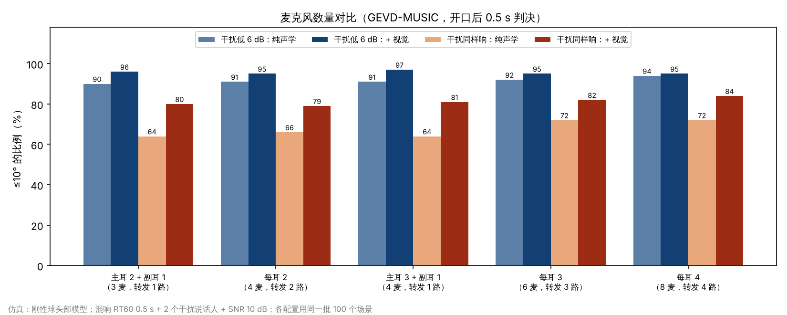

# 耳机摄像头无障碍听觉辅助：整体设计方案 v2.1

> 2026-11-18。按 mentor 的顺序（**应用场景价值 → 整体设计方案** → 具体算法模型），本文回答：场景价值成立的前提；形态与硬件；架构取舍；麦克风数量；输入怎么传输、什么格式编码；耳机与摄像头怎么协同（同时还是先后）与融合流程；耳机怎么输出信号；用户交互、标定、多人、说话人移动；功耗；评价指标。明显问题见 `明显问题排查.md`。
>
> v2.1：补入融合流程（7.3）、降级（7.4）、输出信号（7.5）、说话人移动（8.5）；第 4 节补"已知干扰方位的自适应置零"计算（本地 2 麦约 2 dB、两耳组阵约 8 dB）。
> v2 相对 v1 的修改：更正麦克风数量表述；新增场景价值分析；摄像头分辨率重新设计（v1 的 QVGA 看不清嘴）；架构从"一种"改为"三种并列比较"；新增用户交互、标定、多人、评价指标；功耗总账加入摄像头新方案与不确定项；每条结论标注确定程度。
>
> 标注：**【官方】** 华为官网；**【参考】** 公开资料（多为检索摘要，原文未逐一核实）；**【估算】** 按公式或参考数据计算；**【仿真】** 本项目仿真（刚性球头部模型，代码 `code/earbud_ssl/`）；**【设计】** 本方案的设计选择；**【判断】** 推断，需验证。

## 1. 应用场景价值

### 1.1 用户与需求

- **听力损失或老年人**：本来就需要辅听设备；最大的困难是多人、嘈杂场合听不清和自己说话的那个人（《技术洞察》）。
- **嘈杂环境中的普通用户**：餐厅、聚会、展会；本来就戴着耳机（《技术洞察》）。
- 共同需求：在**几个人同时说话、彼此只隔 20–30°** 的场合，只听清**正在和我说话的那一个人**，并且转头看别处时还能跟住。

### 1.2 已有产品与研究做到了什么

| 产品 / 研究 | 做法 | 能做到 | 做不到 |
|---|---|---|---|
| Apple AirPods Pro：对话增强、听力辅助模式【参考】 | 麦克风波束聚焦**正前方**说话的人；听力辅助模式按听力图补偿 | 增强正前方 | 正前方附近有多个人时，分不出是哪一个；头一转，增强方向就跟着头走【判断】 |
| Meta Ray-Ban Gen 2 "Conversation Focus"（2025-12）【参考】 | 镜腿上 5–6 个麦克风的阵列做波束成形 + 端侧降噪，增强**正前方** | 第三方测试：正前方语音增强效果好 | 同上【判断】；眼镜形态 |
| 助听器双耳指向（如 Signia 的耳间链路，检索摘要提及）【参考】 | 两耳麦克风通过专用耳间链路组成双耳阵列，做窄波束 | 窄波束，低时延 | 波束仍按头朝向；不知道"是哪个人在和我说话"【判断】 |
| 助听器的说话人方向检测与多人增强：Phonak SpeechSensor、Signia IX（2023）【参考，多为厂商资料】 | SpeechSensor 判断主要说话人在前、侧或后方，自动切换指向模式；Signia IX 厂商称可同时跟踪并增强多个说话人，并跟踪头部转动 | 不只增强正前方：能跟随说话人方向，增强整组说话人 | 不区分"哪一个人在和我说话"，增强的是整组【判断】 |
| Look Once to Hear（CHI 2024）【参考】 | 用户先看着目标几秒"注册"声纹，之后用目标说话人提取网络只放大这个人 | 能在多人中只放大一个人；端到端时延目标 < 20 ms | 需要注册步骤；注册网络不在设备上运行 |
| VueBuds（CHI 2026，带摄像头的无线耳机）【参考】 | 耳机上装低功耗摄像头，做视觉问答 | 证明耳机上装摄像头可行：摄像头典型功耗 < 5 mW | 不做听觉辅助 |

### 1.3 本方案的增量价值与前提

- **增量价值【判断】**：用摄像头（人脸 + 唇动）和耳机定位一起，**自动锁定"正在和我说话的那一个人"**（不需要注册），转头后仍跟住（IMU），并把方位交给增强模块。已有助听器能跟随说话人方向、增强整组说话人（Phonak SpeechSensor、Signia IX），但不区分哪一个在和你说话。
- **价值成立的前提**：增强模块必须能把相隔 20–30° 的相邻说话人分开。本地小阵列做不到（第 4 节、`明显问题排查.md` 第 1 项），需要两耳组阵增强或目标说话人提取网络。**这是本场景能否成立的关键前提。**
- 如果该前提不成立，场景可收窄为"知道谁在说话、他在哪"，配合字幕或转写使用【判断】。

## 2. 设计约束

| 约束 | 数值 | 来源 |
|---|---|---|
| 相邻说话人间隔 | 20–30° | 《看哪听哪》第 3 页【参考】 |
| 定位精度 | ≤ 10°，争取 ≤ 5° | 由上一行推出【判断】 |
| 实时听的声音时延 | 入耳式约 10–20 ms；开放式约 5–6 ms | Stone & Moore 2008 等【参考】 |
| 功耗基准 | 每只耳机约 37 mW（通话），续航 6 h | FreeClip 2 S【官方 → 估算】 |
| 交谈距离 | 1–2 m | 面对面交谈的常见距离【判断】 |
| 运行位置 | 全部端侧、离线 | mentor 11-16、11-17 |

## 3. 形态与硬件配置【设计】

| 项目 | 推荐 | 理由 | 备选 |
|---|---|---|---|
| 佩戴形态 | **入耳式（带透传）** | 时延容忍度约 10–20 ms，开放式只有约 5–6 ms【参考】；入耳式挡住大部分直达声，增强声才占主导 | 开放式耳夹（FreeClip 类）：时延要求更严，增强被直达声稀释 |
| 麦克风 | **每只耳机 2 个外部麦克风** + 骨声纹传感器（两耳共 4 个外部麦克风） | 第 5 节：仿真中多装麦克风未见明显收益 | 每耳 3 麦（若增强或通话需要），定位侧无需改动 |
| 惯性传感器 | 陀螺仪 + 加速度计一体（每耳） | 头部转动补偿；FreeClip 2 S 已有【官方】 | — |
| **摄像头** | **两只耳机各 1 个（耳柄）**，朝向需保证正前方 ±30° 有覆盖（参考资料中推荐前倾布局，两边视野在正前方重叠约 20°）【待确认，硬件】；**720p 级传感器、水平视场约 80°**（或 1080p 级、约 100°）；**两级读出**：平时合并像素输出低分辨率整幅做人脸检测，需要时只按原分辨率读出嘴部附近的小区域（ROI）做唇动检测 | 见 3.1：QVGA、100° 时 2 m 外嘴只有约 3 个像素，看不清唇动 | 正前方的人落在两边视野的内侧边缘；广角镜头边缘畸变、分辨率下降，需按实际镜头复核像素 |
| 视觉处理 | 摄像头模组内或耳机芯片上的低功耗 NPU；图像不出模组 | 隐私；只传检测结果 | — |
| 定位与融合 | 主耳音频 DSP | 经典信号处理为主，约 12 MFLOPS【估算】 | — |

### 3.1 摄像头分辨率：看清嘴需要多少像素【估算】

按小孔成像估算（嘴宽约 5 cm、人脸宽约 15 cm）：

| 传感器 | 水平视场 | 嘴宽像素：1 m / 1.5 m / 2 m | 人脸宽像素：1 m / 2 m |
|---|---|---|---|
| QVGA（320 宽，v1 方案） | 100° | 7 / 4 / 3 | 20 / 10 |
| VGA（640 宽） | 100° | 13 / 9 / 7 | 40 / 20 |
| VGA | 60° | 28 / 18 / 14 | 83 / 42 |
| **720p（1280 宽）** | **80°** | **38 / 25 / 19** | 114 / 57 |
| 1080p（1920 宽） | 100° | 40 / 27 / 20 | 121 / 60 |

- 公开研究中，低分辨率网络视频里嘴部约 45 × 17 像素时仍能做唇动检测【参考】；没有找到"最少需要多少像素"的系统结论。本方案暂以"**2 m 处嘴宽 ≥ 约 20 像素**"为设计目标【判断，需视觉同事确认】。
- 人脸检测要求低得多：轻量检测器在大量小于 16 像素的人脸上仍能工作【参考：SCRFD / WIDER FACE】。
- 因此采用**两级读出**：人脸检测用低分辨率整幅（省带宽和算力），唇动只读嘴部 ROI 的原分辨率像素。代价是需要 720p 或 1080p 级传感器，功耗高于 QVGA（见第 10 节）。

### 3.2 为什么分主副耳【设计】

- 测向要用左右耳麦克风之间的相位关系，几路音频必须在同一颗芯片上一起算（协方差、白化、扫描都要用到全部通道），不能两边各算一半。
- 让一只耳机（主耳）汇集并计算：耳间只需单向传 1 路音频（256 kbps），只有一颗 DSP 跑约 12 MFLOPS，结果只回传 8 字节。若两耳各算一遍，链路流量和计算量都翻倍，得到的方位却相同。
- 代价是主耳多耗约 3 mW（定位计算 + 接收）。可按电量定期交换主副角色（主副只是软件角色，两只耳机硬件相同）。
- 一只耳机摘下或链路中断时，剩下的一只自动成为主耳，退化为本地 2 麦定位，置信度降两级（附录 A6）。

## 4. 架构：三种方案并列【设计 + 判断】

**定位与视觉这一侧，三种方案完全相同**（第 6–8 节），区别只在增强怎么做。增强不归我们负责，但它决定场景价值，所以在整体方案里一起比较。

| | A：本地增强 + 定位旁路 | B：耳间低时延链路 + 双耳增强 | C：目标说话人提取网络 |
|---|---|---|---|
| 做法 | 每只耳机用本地 2 麦朝目标方向增强；两耳之间只传定位用的 1 路音频（旁路） | 两耳实时互传麦克风信号，组成双耳阵列做窄波束 | 用方位、唇动、声纹作条件，神经网络从混合声里提取目标人的语音 |
| 能否分开相距 25° 的相邻说话人（信干比提升，0.5–4 kHz 平均） | **基本不能**：固定超指向 0.2–0.5 dB；即使用定位给出的干扰方位做自适应置零，也只有约 2 dB（直达混响比 0 dB 时约 2.4 dB）【理论计算】 | **能**：自适应置零在直达混响比 0 dB 时约 8 dB，消声时约 14 dB（设计方位误差 2–3°）【理论计算】 | 能（不依赖阵列孔径）：Look Once to Hear 在多人中只放大目标【参考】 |
| 声音通路时延 | 本地处理，可做到几 ms | 耳间链路时延 + 处理；星闪约 20 ms、蓝牙 15–40 ms（评测，手机到耳机）【参考】；助听器专用耳间链路交换音频 0.5–5 ms 量级（专利与文献，检索摘要）【参考】；本耳机能否有类似链路【待确认】 | 端到端约 17.5–20 ms（无线耳机 + AI 加速器 17.5 ms；Look Once to Hear 目标 < 20 ms）【参考】 |
| 是否满足入耳式 10–20 ms | 满足 | 专用链路满足；蓝牙 / 星闪不满足 | 临界 |
| 是否满足开放式 5–6 ms | 满足 | 不满足（除非链路做到几 ms） | 不满足 |
| 新增功耗 | 最低（链路约 0.7–2.6 mW） | 双向持续传音频，每侧约 +2.6–5.2 mW（PCM）【估算】 | 网络推理功耗【待查】 |
| 场景价值 | 只能"增强正前方 + 知道是谁"，与已有产品差别小 | 有 | 有 |

**结论【判断】**：
- A 能做、但价值不足；B、C 有价值，但时延都处在入耳式容忍度的边缘，开放式基本不行。
- 本方案的定位输出（目标方位、置信度、是否在说话、干扰方位）**对 A、B、C 三种增强都通用**，定位侧可以先按本方案推进。
- 增强侧选 B 还是 C，取决于两项确认：**耳机之间的专用链路时延能做到多少**、**目标说话人提取网络在耳机芯片上的时延与功耗**。这是整体方案中最需要 mentor 和相关同事判断的一点。

## 5. 麦克风数量：4 / 6 / 8 麦【仿真 + 估算】

**设置**：同一批 100 个场景（混响 RT60 0.5 s、2 个干扰说话人、SNR 10 dB）；GEVD-MUSIC，开口后 0.5 s 判决。

| 配置 | 用于定位的麦 | 副耳转发 | 干扰低 6 dB：纯声学 / + 视觉 | 干扰同样响：纯声学 / + 视觉 | 耳间带宽（PCM） | 定位计算（相对 4 麦） |
|---|---|---|---|---|---|---|
| **主耳 2 + 副耳 1（推荐）** | 3 | **1 路** | 90% / 96% | 64% / 80% | **256 kbps** | 约 0.8 倍 |
| 每耳 2（4 麦） | 4 | 2 路 | 91% / 95% | 66% / 79% | 512 kbps | 1 倍 |
| 主耳 3 + 副耳 1 | 4 | 1 路 | 91% / 97% | 64% / 81% | 256 kbps | 约 1 倍 |
| 每耳 3（6 麦） | 6 | 3 路 | 92% / 95% | 72% / 82% | 768 kbps | 约 1.6 倍 |
| 每耳 4（8 麦） | 8 | 4 路 | 94% / 95% | 72% / 84% | 1024 kbps | 约 2.3 倍 |

**结论**：在本仿真中，多装麦克风没有带来明显收益——配置之间相差 1–8 个百分点，加视觉后 0–4 个百分点，与每档 100 次的统计误差（约 ±4 个百分点）同量级；仿真为理想化刚性球模型。据此**暂定**：每耳 2 麦（两耳共 4 麦），定位时副耳只转发 1 路。**需实测复核**。若选架构 B，增强本身需要更多耳间通道，麦克风与链路要按增强的需求重新定。

## 6. 输入怎么传输、什么格式编码【设计】

### 6.1 数据流规格

| 数据流 | 从 → 到 | 内容与格式 | 速率 | 时延要求 |
|---|---|---|---|---|
| 麦克风采集 | 麦克风 → 本耳芯片 | 数字麦 PDM → 抽取为 **PCM 16 kHz / 16 bit**；定位用 32 ms 帧、16 ms 帧移 | 每路 256 kbps（片内） | — |
| **定位音频** | 副耳 → 主耳（耳间链路） | **1 路 16 kHz，ADPCM 4 bit**（11-23 仿真后改为默认，PCM 16 bit 可选）；带采样计数与时间戳；**两耳采样同步误差 ≤ 50 µs**（6.2） | 64 kbps（PCM 256 kbps） | ≤ 100 ms（旁路） |
| 摄像头 → NPU（片内 / 模组内） | 传感器 → NPU | 平时：合并像素的低分辨率整幅（约 QVGA）；需要时：嘴部 ROI 原分辨率（如 64 × 64 像素） | 模组内，不出模组 | — |
| 人脸元数据 | NPU → 本耳芯片 →（副耳的经耳间链路）→ 主耳 | 每张人脸 16 字节：曝光时间戳 4 B、人脸编号 1 B、方位角 2 B（0.01°）、仰角 2 B、人脸框大小 2 B、唇动分数 1 B、检测置信度 1 B、保留 3 B | 最多 5 张脸 × 15 fps ≈ 1.2 kB/s；平时 < 0.2 kB/s | ≤ 100 ms |
| 摄像头控制 | 主耳 → 两耳摄像头 | 开 / 关、档位（监测 / 人脸 / 唇动 ROI）、ROI 坐标 | 事件触发，几十字节 | ≤ 50 ms |
| 头部朝向 | IMU → 本耳芯片 | 偏航角，200 Hz | 片内 | — |
| **定位结果** | 主耳 → 两耳增强模块 | 每 16 ms 8 字节：目标方位 2 B、置信度 1 B、是否在说话 1 B、主要干扰方位 3 × 1 B、序号 1 B | 0.5 kB/s | ≤ 50 ms |

### 6.2 两耳同步

- 仿真：同步误差 ≤ 50 µs 时定位精度不变，100 µs 时 ≤10° 的比例从 63% 降到 8%【仿真】。
- 可行性参考：ClearBuds（两只无线耳机组成同步麦克风阵列）报道的同步误差 < 64 µs【参考】；TWS 播放侧左右同步通常 < 25 µs【参考】。说明这个量级有先例，但 50 µs 比 ClearBuds 还紧，采集侧的实现方式**待与芯片 / 链路同事确认**。

### 6.3 编码的取舍

| 编码 | 码率 | 优点 | 风险 |
|---|---|---|---|
| PCM 16 bit（可选） | 256 kbps | 相位信息完整 | 链路功耗最高（每侧约 2.6 mW【估算】） |
| ADPCM 4 bit（11-23 起默认） | 64 kbps | 功耗约为 1/4，时延低 | 加视觉时与 PCM 无差别；纯声学、干扰一样响时低 3 个百分点，不显著【仿真，`编码对测向的影响.md`】 |
| LC3 | 32 kbps（16 kHz 语音档）【参考】 | 码率最低 | 同为感知编码的 Opus 32 kbps 加视觉时低 3–7.5 个百分点，不用于定位【仿真】；编解码时延约 10 ms 级【参考】 |

## 7. 耳机与摄像头怎么协同：同时还是先后？【设计】

摄像头分两档【设计】：**低帧率档**（1–2 fps，低分辨率，只找人脸位置，约 0.4–0.8 mW）在使用中一直开；**高帧率档**（10–15 fps，只读嘴部区域，NPU 判断嘴是否在动、何时开口，传感器 + NPU 约 1.2–11 mW【估算】）在对话中一直开。对应 mentor 11-20 工作流程图中的"低帧率"和"提高帧率"。

**回答：两者同时运行（并行），按事件切换摄像头档位；在一次定位里有明确的先后。**

### 7.1 一次定位的先后顺序（11-18 按协同时序仿真修订）【设计 + 仿真】

> 修订原因：旧版写"声音先发现说话人 → 叫醒摄像头 → 唇动给出开口时刻"，但摄像头在对方开口之后才被叫醒，看不到开口那一刻。协同时序仿真（`code/earbud_ssl/scripts/run_timing.py`，结果 `out/timing.json`，每个条件 100 次）给出了时间要求，并显示只靠声学检测开口不可靠，因此改为"对话中摄像头保持高帧率档"。
>
> **11-21 再修订**（mentor 11-20："摄像头功耗高，常开的算法增益大不大，或者检测到声音后再开"）：多人对话的摄像头策略仿真（`摄像头使用策略.md`）表明，高帧率档常开的增益集中在换人那一刻（锁定 0.25 s 对约 0.45 s；换人后 0.5 s 内 62–71% 对 29–40%），稳定段只高 3–7 个百分点；"声学检测到声音后再开高帧率档"比只开低帧率档没有更好。因此改为**两种工作方式**：默认只开低分辨率低帧率档（看人脸位置），声学测向并检测开口；高精度方式高帧率档常开（下表的时间轴）。只读嘴部区域的功耗若在约 4 mW 以内，常开与默认方式续航相当，应改为默认。
>
> **11-23 再修订**：补了两项依据后建议回到"对话中高帧率档常开"：① 按传感器 + NPU 的公开数据估算高帧率档约 1.2–11 mW（只看嘴部的轻量唇动模型约 1.2–2.6 mW），而只开低帧率档时换人要靠声学开口检测、定位计算多约 6.6 MFLOPS，两者续航相当（4.6–5.3 h 对 4.9–5.2 h）；② 预测式开启（上一个人说完即开）只在没有重叠的轮流对话中有效。高帧率档功耗若经视觉同事确认明显超过约 4 mW，退回只开低帧率档。详见 `摄像头使用策略.md` 第 7、8 节。

**高帧率档常开时，轮到下一个人说话（t = 0 为对方开口）**

| 时刻 | 摄像头 | 音频 | 输出 |
|---|---|---|---|
| t < 0 | 高帧率档（只读正前方 ±30° 内人脸的嘴部区域，10–15 fps） | 背景递推：只用对方闭嘴的帧，至少 0.5 s，时间常数 1 s | 保持上一个目标 |
| t = 0 | 唇动给出开口时刻（误差需 ≤ ±0.1 s） | 开始累计目标帧（起始段加权） | — |
| 0.3 s | 人脸方位、唇动分数参与融合 | 第一次扫描 | 初步方位（加视觉 86%）【仿真】 |
| 0.5 s | — | — | 锁定（加视觉 89–95%）【仿真】，之后每 16 ms 输出 |

**各种情况**

| 情况 | 摄像头 | 开口时刻由谁给 | 锁定 |
|---|---|---|---|
| 对话中（推荐） | 高帧率档常开：只看正前方 ±30° 内人脸的嘴部，轻量唇动模型，10–15 fps | 唇动 | 换人后 0.25 s【仿真，多人对话】；首次锁定 0.3 s 初步、0.5 s 锁定【仿真，2 个干扰一直说话】 |
| 对话中，高帧率档功耗偏高时 | 只开低帧率档，1–2 fps，只看人脸位置 | 声学检测（阈值 3.5 dB）；人脸位置校正方位 | 换人后约 0.42–0.51 s【仿真，多人对话】 |
| 安静（3 s 无人说话） | 低帧率档，1–2 fps | — | 保持上一个目标 |
| 暗光、遮挡、目标在视野外 | 关或低帧率档 | 声学 | 纯声学，置信度降一级 |

**仿真得出的时间要求**（2+1 阵列，混响 RT60 0.5 s + 2 个干扰说话人；"干扰低 6 dB / 干扰一样响"）【仿真】

| 问题 | 结果 | 设计取值 |
|---|---|---|
| 开口后要听多久（加视觉） | 0.1 s：81 / 73%；0.3 s：86 / 86%；0.5 s：95 / 89%；0.8 s：100 / 89% | 0.3 s 初步，0.5 s 锁定 |
| 开口时刻偏差（纯声学，负为偏早） | −0.2 s：80 / 54%；−0.1 s：93 / 70%；0：97 / 81%；+0.1 s：96 / 82%；+0.2 s：88 / 73% | 唇动开口时刻误差 ≤ ±0.1 s；偏早影响更大 |
| 开口前背景长度（纯声学） | 0.1 s：84 / 62%；0.5 s：94 / 76%；1 s：96 / 79% | 至少 0.5 s，时间常数 1 s |
| 只靠声学检测开口 | 阈值 2.0 dB：检出 76 / 59%，每分钟误报 33 / 46 次；3.0 dB：检出 39 / 17%，误报 5 / 12 次 | 检出与误报无法兼顾 → 唇动给的开口时刻更准；只开低帧率档时只能用声学检测（3.5 dB），换人时比高帧率档常开慢约 0.2 s（11-21 摄像头策略仿真） |
| 干扰有停顿时只靠声学检测开口（`run_onset_pauses.py`） | 干扰说一段停一段：3.0 dB 阈值检出 54 / 38%，每分钟误报 11 / 19 次；轮流说话：检出 46 / 20%，误报 9 / 17 次。没有比干扰一直说话时更好——干扰重新开口同样触发 | 结论不变 |

### 7.2 状态机

| 状态 | 进入条件 | 音频 | 摄像头 | 输出 |
|---|---|---|---|---|
| 待机 | 未开启听觉辅助 | 关 | 关 | — |
| 安静 | 3 s 内无人说话 | 背景递推、跟踪上一个目标 | 低帧率档（1–2 fps） | 保持上一个目标 |
| 对话中 | 声学检测到语音，且正前方 ±30° 内有人脸 | 定位 + 唇动门控背景；退回只开低帧率档时加声学开口检测 | 高帧率档常开，只读嘴部区域（10–15 fps）；功耗偏高时只开低帧率档 | 目标方位、置信度 |
| 确认 | 前后判断不一致 / 置信度低 / 转头 > 30° | 定位 | 高帧率档，持续到确认完成 | 保持上一次目标 |
| 降级 | 光线差、被遮挡、目标在视野外 | 纯声学 | 关或低帧率档 | 目标方位，置信度降一级 |

**功耗影响**：高帧率档常开时，高帧率档（传感器 + NPU）约 1.2–11 mW、对话时间内常开；只开低帧率档时只多 0.4–0.8 mW，但定位计算多一步声学开口检测（约 +6.6 MFLOPS）。见第 10 节。

### 7.3 融合流程（主耳，每 16 ms 一次）【设计】

**说话人地图**（世界坐标，主耳维护）：每个人一条记录——人脸编号、方位、最近一次被视觉确认的时刻、唇动分数、是否在说话、是否为目标。

| 步骤 | 做什么 | 输入 | 输出 |
|---|---|---|---|
| 1 头部朝向 | 积分 IMU 偏航角，得到当前头部朝向 | IMU | 头部朝向 |
| 2 自语音判断 | 骨声纹检测到佩戴者在说话时，本帧不参与定位、不更新地图 | 骨声纹传感器 | 是否跳过 |
| 3 背景更新 | 只用"目标嘴闭上超过 0.2 s"的帧递推更新背景协方差（时间常数约 1 s） | 3 路音频、唇动 | 背景协方差 |
| 4 声学空间谱 | 对方开口后，用开口后的帧算空间协方差，用背景白化后在 72 个方向（5° 间隔）上扫描，再换到世界坐标 | 3 路音频、背景、开口时刻、头部朝向 | 空间谱 |
| 5 地图更新 | 视觉结果按曝光时刻的头部朝向换到世界坐标，更新或新建地图中的人 | 人脸元数据、头部朝向 | 说话人地图 |
| 6 软融合 | 每个候选人的得分 = 空间谱在其方位 ±8° 内的最大值 + 0.1 ×（唇动分数 − 0.5）；空间谱峰值本身也作为一个"无人脸"候选，得分 = 峰值 − 0.05；取得分最高者 | 空间谱、说话人地图 | 当前说话人及其方位 |
| 7 新声源 | 声学峰值附近没有人脸、且持续出现 → 记为新声源，摄像头切到高帧率档确认 | 空间谱、地图 | 摄像头控制 |
| 8 目标锁定与切换 | 按第 8.1 节的规则锁定或切换目标 | 当前说话人、用户操作 | 目标 |
| 9 输出 | 目标方位换回头部坐标，连同置信度、是否在说话、主要干扰方位下发两耳 | 目标、地图、头部朝向 | 定位结果（第 7.5 节） |

- 视觉缺失时第 6 步只剩"无人脸"候选，结果就是纯声学，**不会因为视觉差而比纯声学更差**（仿真中四类条件都成立）。
- 只在"唇动分数高"的人脸里选的硬规则会在唇动误判时排除目标，仿真中反而比纯声学低约 5 个百分点，所以不用【仿真】。
- 步骤 3、4 依赖唇动给出的时刻：这是视觉参与声学测向的具体环节，不只是最后校正方向。

### 7.4 降级

| 情况 | 行为 |
|---|---|
| 目标在摄像头视野外（侧后方） | 用地图记住的位置 + 声学空间谱；置信度降一级 |
| 光线太暗、摄像头被遮挡 | 纯声学；地图保持最后一次的结果；开口时刻改用声学语音检测 |
| 视觉说某人在说话、声学没有活动 | 不认为在说话（过滤唇动误报，如吃东西） |
| 佩戴者自己在说话 | 冻结定位与地图更新 |
| 谁都没在说话 | 保持目标方向不变 |
| 两耳链路中断 | 主耳退化为本地 2 麦定位（只能大致分左右前后），置信度降两级 |

### 7.5 输出：耳机怎么输出信号【设计】

**定位结果（我们的输出，给增强模块）**：每 16 ms 一条，见第 6.1 节"定位结果"。定位是旁路控制，计算时延只影响"转向新目标要多快"，不增加用户听到的声音时延。

**声音输出（增强模块负责，这里定接口和要求）**：

| 项目 | 设计 | 说明 |
|---|---|---|
| 增强对象 | 目标方向的语音；`active` 为否（目标没在说话）时降低增强量，避免放大噪声 | 由定位结果驱动 |
| 输出形态 | 两耳播放同一路增强后的目标语音（与《技术洞察》"直接播放单路语音"一致）；按方位还原方向感属于音效渲染，《技术洞察》第 8 页定为现阶段不做 | 定位输出的方位可作为以后音效渲染的输入 |
| 与透传混合 | 输出 = 目标增强声 + 透传环境声；两者比例可调（默认目标比环境高约 6–12 dB【判断，需用户测试】），总输出过限幅器 | 保留环境感知（安全） |
| 自己说话 | 骨声纹检测到自语音时，降低透传中自己声音的增益 | 避免"自己的声音被放大" |
| 时延 | 声音通路端到端：入耳式 ≤ 约 10–20 ms，开放式 ≤ 约 5–6 ms【参考】；架构 A 在本地处理，可做到几 ms；B、C 见第 4 节 | 增强模块的约束 |

### 7.6 一个声音进来：接收与逐步处理【设计 / 估算】

> 11-18 mentor 反馈融合流程"太泛"，要讲清"一个声音进来，耳机通过啥接收，信号咋处理"。本节按信号链逐步写明。

**接收**

| 环节 | 器件 / 位置 | 输出 |
|---|---|---|
| 声波 → 麦克风 | 每耳 2 个 MEMS 数字麦，耳柄前后，间距 1.5 cm | PDM 1 bit，时钟约 1–3 MHz |
| 抽取滤波 | 本耳音频编解码器 | PCM；定位支路 16 kHz / 16 bit；实时听通路按增强模块需求，不经过定位 |
| 副耳转发 | 副耳芯片取 1 路，加采样计数 | 经耳间链路，1 路 PCM，256 kbps |
| 对齐 | 主耳音频 DSP 按两耳采样计数对齐 | 3 路对齐的 16 kHz 音频（同步误差 ≤ 50 µs） |
| 其他输入 | 骨声纹传感器、IMU、两耳摄像头 + NPU | 自语音标志（每 16 ms）；偏航角（200 Hz）；人脸元数据（每张 16 字节，副耳的经耳间链路） |

**处理（主耳音频 DSP）**

| 步骤 | 做什么 | 输入 → 输出 | 参数 | 每秒计算量 |
|---|---|---|---|---|
| 1 高通 | 去直流和低频风噪 | 3 路 PCM → 3 路 PCM | 4 阶，100 Hz（设计值） | 1.0 M |
| 2 分帧 + FFT | 每 16 ms 取最近 32 ms，加汉宁窗做 FFT | 3 × 512 点 → 3 × 218 个频点 | 保留 200–7000 Hz | 1.2 M |
| 3 判帧 | 用唇动、能量、骨声纹判断帧类型 | → 背景 / 目标 / 跳过 | 目标嘴闭上 > 0.2 s 为背景；开口后为目标；佩戴者说话跳过 | 0.2 M |
| 4 协方差 | 每频点 3 路相关矩阵，背景、目标各一份 | → 218 × 两个 3×3 | 背景递推，时间常数约 1 s；目标从开口起累计，起始段加权 | 0.7 M |
| 5 背景白化 | Cholesky 白化后特征分解 | → 218 个噪声子空间 | 每 0.25 s 一次 | 1.0 M |
| 6 方向扫描 | 72 个方向的预存模板与噪声子空间比较，频点平均 | → 72 个分数（空间谱） | 5° 网格；模板含头部影响，约 184 KB（复数半精度） | 8.2 M |
| 7 找峰 | 峰值 + 抛物线插值 | → 候选方位 | 在 5° 网格之间插值 | 很小 |
| 8 与人脸融合 | 人脸方位 ±8° 内空间谱最大值 + 0.1 ×（唇动 − 0.5）；纯声学峰值 − 0.05 参选 | → 目标方位 | 人脸方位按曝光时刻 IMU 换到世界坐标 | 很小 |
| 9 输出 | IMU 换回头部坐标，打包下发两耳增强 | → 8 字节 | 每 16 ms；开口后约 0.5 s 首次锁定 | 很小 |
| 合计 | | | 内存：模板约 184 KB + 协方差约 31 KB | 约 12 M |

计算量按 3 路、218 个频点、72 个方向、每 0.25 s 扫描一次估算（扫描间隔为设计值，其余参数与仿真一致）；有人脸时只扫人脸附近 ±10°，第 6 步约降到 1.7 M。

**从控制量到耳朵（每只耳机）**：定位结果（8 字节 / 16 ms）→ 增强（朝目标方位，干扰方位置零）→ 与透传混合（目标比透传高 6–12 dB）→ 限幅 → 扬声器（两耳同一路）。

**输出规则【设计值，需体验测试调整】**

| 情况 | 输出怎么变 | 取值 |
|---|---|---|
| 目标换人或方位跳变 > 10° | 在新旧方位之间渐变，避免声音突跳 | 0.2 s 内完成 |
| 置信度 < 0.5 | 增强量减半，接近透传 | 置信度恢复后 0.5 s 内回到正常 |
| 目标没在说话 | 增强量降低，避免放大背景噪声 | 降 6 dB |
| 佩戴者自己说话 | 冻结方位；透传中自己声音降增益 | 骨声纹判断 |
| 两耳链路中断 | 用最近一次方位；超时后退回透传 | 1 s |

### 7.7 时间同步与标定【设计 / 估算】

| 项目 | 问题 | 做法 | 要求 |
|---|---|---|---|
| 两耳采样时钟漂移 | 两颗晶振相差 20 ppm 时，每 2.5 s 漂 50 µs，正好用完同步预算 | 副耳每帧带采样计数；主耳持续估计漂移，用重采样补偿 | 对齐误差 ≤ 50 µs【待确认，链路 / 芯片】 |
| 副耳音频晚到 | 耳间链路有时延 | 主耳本地 2 路先缓存，等副耳数据到达后对齐 | 缓存 100 ms，约 6.4 KB |
| 摄像头与音频的时间基准 | 曝光时间和采样时刻来自不同时钟 | 曝光时间戳统一换算到主耳音频时钟 | 误差 ≤ 20 ms（开口时刻总误差需 ≤ ±0.1 s，10–15 fps 本身已有 67–100 ms 帧间隔） |
| 摄像头不在头部中心 | 摄像头在耳柄上，离头部中心约 8 cm；不换算时 1 m 处差约 4.6°、2 m 处约 2.3° | 按人脸大小估距离，把人脸方位换算到头部中心 | 换算后残差 ≤ 1° |
| IMU 偏航角漂移 | 陀螺积分会慢慢漂 | 用人脸方位和声学峰值定期重新校准说话人地图 | 漂移在 ±5° 内被校正 |
| 摄像头与麦克风相对位置 | 每副耳机装配有偏差 | 出厂标定，写入方向模板与换算参数 | — |

## 8. 用户交互、标定、多人【设计】

### 8.1 选人与切换

| 方式 | 规则 | 说明 |
|---|---|---|
| 自动（默认） | 正前方 ±30° 内、唇动与声学都显示在说话的人 | 不需要注册步骤（区别于 Look Once to Hear） |
| 看向切换 | 用户把头转向另一个人并停留约 1 s，且此人在说话 | 利用 IMU + 视觉；停留时长需用户测试确定【判断】 |
| 手动 | 点按耳机：切到"正前方正在说话的人"；长按：退出锁定，回到增强正前方 | 兜底 |
| 自动切换的防抖 | 另一个人在正前方连续说话约 2 s、且原目标不在说话，才切换 | 避免插话导致来回切换【判断】 |

### 8.2 锁定时延对体验的影响

- 新说话人开口后约 0.5 s 才锁定【仿真设置】，开头半秒按增强前的状态播放，可能漏掉开头几个字【判断】。
- 缓解：稳定对话中，交谈的人已在说话人地图里（锁定状态），轮到他说话时**不需要重新定位**，增强方向可立即切换；只有新加入的人才有约 0.5 s 延迟。唇动通常与发声同时或略早，高帧率档下可提前切换【判断，待验证】。

### 8.3 标定与佩戴偏差

- 摄像头与麦克风的相对位置在出厂时标定（同一个耳机壳内，固定）。
- 每次佩戴的角度不同：当视野里只有一个人在说话时，比较"人脸方位"与"声学方位"，在线校正耳机相对头部的偏转【设计】；陀螺仪漂移同样用视觉重新检测到同一个人时校正。

### 8.4 多人对话

- 说话人地图同时保存视野内的多个人；"目标"可以是一组人（例如同桌的 2–3 个人），增强对准其中正在说话的那一个【设计】。
- 多人同时说话时，优先当前目标；其余人的方位作为"主要干扰方位"交给增强模块（可用于置零）。

### 8.5 说话人移动（后续扩展）【设计】

固定说话人的结构可以直接扩展：

- 说话人地图中每个人从"固定方位"改为"方位 + 角速度"，用圆周卡尔曼滤波跟踪（场景一已有实现，可复用）。
- 视觉的人脸编号负责"是同一个人"的身份延续；人走出视野后靠声学继续跟，回到视野后重新确认。
- 摄像头触发增加一条：跟踪的预测误差变大时切到高帧率档。
- 移动时视觉的几十毫秒时延会带来方位偏差，需要按曝光时刻外推。
- 背景白化在说话人移动时可能把目标的一部分"白化"掉，需要在 12 月的仿真中验证。
- **仿真结果（11-18，`动态定位仿真.md`）**【仿真】：慢速移动（≤ 20°/s）跟踪 + 视觉 85–92% / 73–84%（干扰低 6 dB / 一样响）；快速移动（40°/s）降到 69 / 53%，不如只用最近 0.25 s 测向（77 / 67%），12 月改为以人脸跟踪为主、声学确认。转头 30° / 60° 时 IMU + 视觉 87 / 77%、77 / 67%；只用 IMU 帮助小。

## 9. 定位算法（预研储备，整体方案确认后再定）

仿真中的倾向（`算法选型.md`、`稳健性验证.md`）：GEVD-MUSIC（唇动门控背景白化）+ 起始段加权 + 头部模板 + 5° 网格，与人脸软融合。这里只用它回答整体方案的问题：
- 两耳必须组阵测向（只传参数的路线在嘈杂时只有 37%，组阵 86%）【仿真】；
- 需要"背景白化"，唇动给出开口时刻并决定背景用哪些帧——这是音频与视觉协同的具体落点【仿真】；
- 算力约 12 MFLOPS，模板约 120–250 KB + 状态约 54 KB【估算】。

## 10. 功耗总账（以 FreeClip 2 S 为基准）

**基准**：每只耳机 60 mAh【官方】；通话续航 6 h → 平均约 37 mW / 只（按 3.7 V）【估算】。**每多 1 mW，续航约少 10 分钟**【估算】。

| 新增部分（架构 A，每只耳机） | 功耗 | 依据 |
|---|---|---|
| 耳间定位音频（1 路 ADPCM 64 kbps；PCM 为 2.6 mW） | 约 0.7 mW | 【估算】nRF5340 2M PHY 射频约 5 nJ/bit【参考】，协议开销按 ×2【判断】 |
| 定位与融合计算（高帧率档常开约 12 MFLOPS；只开低帧率档时加声学开口检测约 19 MFLOPS） | ≤ 约 3 mW / 4.6 mW | 【估算】按偏老工艺 MCU 约 0.19 mW/MHz【参考】折算，作为上限 |
| 摄像头低帧率档（低分辨率，1–2 fps） | 约 0.4–0.8 mW | 【参考】HM0360 常开监测模式 140–256 µA，按约 3 V 估 |
| 摄像头高帧率档（对话中常开） | 传感器约 1.2–1.7 mW + NPU 约 0.3–9 mW（只看嘴部的轻量模型约 0.03–0.9 mW）；对话占一半时平均减半 | 【估算】传感器按 HM0360 低分辨率 10–15 fps 插值【参考】；NPU 按 Light-ASD 每张脸每帧约 0.2 GFLOPs【参考】、1–3 张脸、能效 1–6 TOPS/W【判断】；详见 `摄像头使用策略.md` 第 7 节 |
| NPU 低帧率档人脸检测（1–2 fps，低分辨率） | 很小，未计入 | 需目标芯片数据【待查】 |
| 增强（A：本地 2 麦） | 与现有通话降噪相当（已在基准内）【判断】 | — |

| 组合（对话占使用时间一半） | 新增 | 续航（基准 6 h） |
|---|---|---|
| **A + 高帧率档常开，只看嘴部的轻量唇动模型**（推荐） | 约 4.5–7.3 mW | 约 5.0–5.3 h |
| A + 高帧率档常开，Light-ASD 量级 | 约 4.7–11 mW | 约 4.6–5.3 h |
| A + 只开低帧率档（加声学开口检测） | 约 5.7–8 mW | 约 4.9–5.2 h |
| A + 高帧率档按传感器全幅 60 fps（上限，v2 的估法） | 约 11–47 mW | 约 2.6–4.6 h |
| B（再加双向持续传音频，每侧 +2.6–5.2 mW） | 约 7–17 mW | 约 4.1–5.0 h |
| C（再加网络推理） | 约 4.5–11 mW + 网络【待查】 | 【待查】 |

**结论【估算】**（11-23 按传感器 + NPU 估算修订，对话占使用时间一半）：高帧率档常开时续航约 4.6–5.3 h（只看嘴部的轻量唇动模型 5.0–5.3 h；Light-ASD 量级 4.6–5.3 h），只开低帧率档 4.9–5.2 h，差别在约 0.5 h 内；按 mentor 图一的 25 fps、3 张脸全量说话人检测约 4.3–5.1 h；按传感器全幅 60 fps 的上限为 2.6–4.6 h。**高帧率档（传感器 + NPU）的实际功耗是关键数字**【待确认，视觉 / 传感器同事】。详见 `摄像头使用策略.md`。

## 11. 评价指标【设计】

| 层级 | 指标 | 说明 |
|---|---|---|
| 定位 | 方位误差 ≤ 10° / ≤ 5° 的比例、平均误差 | 相邻说话人间隔 20–30° |
| 定位 | 前后混淆率、左右混淆率 | — |
| 锁人 | 锁定正确率（锁的是不是对的人） | 多人同时说话 |
| 锁人 | 锁定时间（开口 → 锁定）、切换时间、每分钟误切换次数 | 体验相关 |
| 视觉 | 摄像头各档位占空比、唇动检测正确率 | 功耗代理 |
| 系统 | 增强后目标语音 SI-SDR / STOI 提升、主观可懂度 | 需增强模块配合 |
| 系统 | 声音通路端到端时延 | 入耳式 ≤ 10–20 ms |
| 系统 | 续航 | 以 FreeClip 2 S 的 6 h 为基准 |

## 12. 结论的确定程度

| 结论 | 依据类型 | 确定程度 |
|---|---|---|
| 两耳必须组阵测向（只传参数不行） | 仿真（刚性球） | 较高（差距大：37% vs 86%） |
| 需要背景白化；SRP-PHAT 不适用 | 仿真（含墙面反射） | 较高（差距大） |
| 两耳同步需 ≤ 50 µs | 仿真 + 参考先例 | 中（仿真有结论，实现方式待确认） |
| 每耳 2 麦、定位只转发 1 路 | 仿真 | 中低（差距与统计误差同量级） |
| 摄像头需 720p / 1080p 级 + 两级读出 | 估算 | 中（像素门槛待视觉同事确认） |
| 本地 2 麦分不开相邻说话人 | 理论计算（固定波束与自适应置零） | 较高（自适应置零也只有约 2 dB；两耳组阵约 8 dB） |
| 高帧率档对话中一直开：换人后 0.25 s 锁定，只开低帧率档约 0.45 s；听到声音再开没有增益 | 仿真（多人对话，4 种条件各 40 段） | 中（视觉为假设模拟） |
| 续航：高帧率档常开约 4.6–5.3 h，只开低帧率档 4.9–5.2 h（对话占一半） | 估算（传感器 + NPU 按公开资料） | 低（嘴部区域读出、轻量唇动模型、目标芯片 NPU 功耗均无实测） |
| 场景价值成立 | 判断 | **取决于增强能否分开相邻说话人（第 4 节）** |

## 13. 待确认 / 待验证

| 项目 | 找谁 / 怎么做 |
|---|---|
| **耳机之间专用链路的时延能做到多少**（决定架构 B） | 链路 / 芯片同事 |
| **目标说话人提取网络在耳机芯片上的时延与功耗**（决定架构 C） | 增强 / 芯片同事 |
| 佩戴形态（入耳式 or 开放式） | 产品侧 |
| 两耳采样同步 ≤ 50 µs 的实现方式 | 链路 / 芯片同事 |
| 唇动检测需要的嘴部像素数、NPU 功耗、真实精度 | 视觉同事 |
| 720p / 1080p 级传感器 ROI 读出的功耗 | 查传感器资料 |
| LC3 本身对测向的影响（目前用 Opus 代替） | 仿真（我们），需要能运行 LC3 的环境 |
| 实测头部传递函数复核 | 样机数据优先；否则用公开的 MMHR-HRTF（Kayser 2009 库限非商业用途，不用）；见 `12月仿真计划.md` |
| 12 月是否需要可听的增强样例、由谁提供增强模块 | mentor（涉及分工） |

## 14. 来源

- FreeClip 2 S 规格：`资料/FreeClip2S_规格与功耗基准.md`
- 时延容忍度：[Stone & Moore 2008（开放式约 5–6 ms）](https://www.researchgate.net/publication/5266175_Tolerable_Hearing_Aid_Delays_V_Estimation_of_Limits_for_Open_Canal_Fittings)、[Widex：hearing aid group delays](https://www.widexpro.com/-/media/widex/global/files/widex-press/widexpress_44_2021-02_quantifying-acoustic-distortions.pdf)
- 已有产品：[HearingTracker：Meta Conversation Focus](https://www.hearingtracker.com/news/meta-ray-ban-gen-2-conversation-focus-ai-speech-enhancement-for-hearing-loss)、[HearingTracker：Ray-Ban Meta 听力测试](https://www.hearingtracker.com/hearing-glasses/meta-ray-ban-glasses-in-hearadvisor-testing-how-do-they-perform-as-hearing-aids)、[Hearing Review：AirPods Pro Conversation Boost](https://hearingreview.com/inside-hearing/events/apple-announces-conversation-boost-for-airpods-pro)、[Hearing Gadget Update Nov 2026](https://techenhancedlife.substack.com/p/hearing-gadget-update-nov-2026)
- 研究：[Look Once to Hear（CHI 2024）](https://arxiv.org/html/2405.06289v2)、[Wireless Hearables With Programmable Speech AI Accelerators](https://arxiv.org/pdf/2503.18698)、[ClearBuds（MobiSys 2022）](https://arxiv.org/abs/2206.13611)、[VueBuds（CHI 2026）](https://arxiv.org/abs/2603.29095)、[VueBuds 项目页](https://vuebuds.cs.washington.edu/)、[Samsung：TWS 低时延语音增强](https://research.samsung.com/blog/Speech-Boosting-Low-Latency-Live-Speech-Enhancement-for-TWS-Earbuds)
- VueBuds 双摄像头视场：[UW News](https://www.washington.edu/news/2026/04/14/cameras-in-wireless-earbuds-vuebuds/)、[arXiv 2603.29095](https://arxiv.org/abs/2603.29095)
- 星闪时延与带宽：[audioXpress：Wireless High-Fidelity Audio Technologies from China](https://audioxpress.com/article/wireless-high-fidelity-audio-made-in-china)、[FreeBuds Pro 5 评测](https://ngxptech.com/huawei-freebuds-pro-5-review-is-nearlink-better/)
- 同步：[audioXpress：LE Audio 测试指南 Part 4](https://audioxpress.com/article/evaluating-and-testing-bluetooth-le-audio-performance-a-guide-for-developers-part-4)
- 编码：[LC3 码率与时延](https://www.forasoft.com/learn/audio-for-video/articles-audio/lc3-lc3plus-bluetooth-le-audio)
- 唇动与人脸检测：[Liu 等：Visual VAD with Adaboosting](https://personalpages.surrey.ac.uk/w.wang/papers/LiuWJ_SSPD_2011.pdf)、[Siatras 等：Visual Lip Activity Detection](https://www.researchgate.net/publication/224358316_Visual_Lip_Activity_Detection_and_Speaker_Detection_Using_Mouth_Region_Intensities)、[SCRFD（ICLR 2022）](https://arxiv.org/abs/2105.04714)
- 器件功耗：[nRF5340 Product Brief](https://www.nordicsemi.com/-/media/Software-and-other-downloads/Product-Briefs/nRF5340-SoC-PB.pdf)、[Infineon IM66D130M](https://www.infineon.com/assets/row/public/documents/24/49/infineon-im66d130m-datasheet-en.pdf)、[Himax HM01B0](https://www.himax.com.tw/products/cmos-image-sensor/always-on-vision-sensors/hm01b0/)、[Himax HM0360 发布](https://www.eejournal.com/industry_news/himax-launches-hm0360-1-6-vga-ultra-low-power-cmos-image-sensor-for-aiot-and-computer-vision-applications/)、[HM0360 数据手册](https://mm.digikey.com/Volume0/opasdata/d220001/medias/docus/4287/HM0360-MWA-00FP963.pdf)、[NXP AN13468](https://www.zlgmcu.com/data/upload/file/Utilitymcu/AN13468-i.MX%20RT600%20Power%20Management.pdf)；OV02C 功耗引自 `资料/room_acoustic_rendering_design.md`
