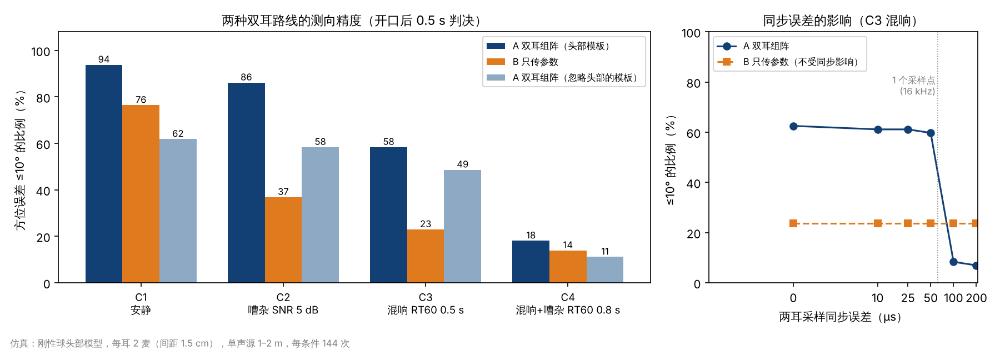

# 最小验证：两耳组阵 vs 只传参数（刚性球头部模型）

> 2026-11-18。代码 `code/earbud_ssl/`，原始结果 `code/earbud_ssl/out/min_validation_*`。
> 以下数字均为**仿真结果**；解读部分标【判断】。

## 1. 要回答的问题

技术方案 v0.2 第 5.2 节列了两条路线：

- **路线 A：两耳组阵**（《技术洞察》第 6 页的思路）。两耳音频汇到一起，4 麦联合测向，需要两耳采样同步。
- **路线 B：只传参数**（我们的提议）。每只耳机用本地前后两麦分前后，两耳之间只交换频带能量，用电平差分左右，不需要同步。

最小验证回答三个问题：

1. 路线 B 能不能达到路线 A 的精度？
2. 路线 A 对两耳同步误差的容忍度是多少？
3. 测向模板要不要考虑头部？

## 2. 设置

| 项目 | 设置 |
|---|---|
| 头部模型 | 刚性球，半径 8.75 cm，解析解（Duda & Martens 1998）；无耳廓 |
| 麦克风 | 每耳 2 麦，耳柄上前后排列，间距 1.5 cm，离头表面 0.8 cm |
| 声源 | 单个说话人，水平面任意方位，距离 1–2 m 随机；1 s 语音片段 |
| 条件 | C1 安静（SNR 20 dB）；C2 嘈杂（扩散噪声 SNR 5 dB）；C3 混响（RT60 0.5 s，直达混响比 0 dB，SNR 10 dB）；C4 混响 + 嘈杂（RT60 0.8 s，直达混响比 −3 dB，SNR 5 dB） |
| 次数 | 每个条件 144 次（72 个方位 × 2） |
| 测向 | 1° 网格；SRP-PHAT 200–7000 Hz；耳间电平差 8 个频带（0.5–7.5 kHz） |
| 路线 B 的权重 | 在单独的随机种子上调到最好后固定，再在评测种子上测试 |

## 3. 结果

方位误差 ≤ 10° 的比例（开口后 0.5 s 判决；括号内为 1.0 s 判决）：

| 条件 | A 两耳组阵 | B 只传参数 | A 但模板忽略头部 | 仅耳间电平差 | 仅每耳本地两麦 |
|---|---|---|---|---|---|
| C1 安静 | **94%**（100%） | 76%（81%） | 62%（67%） | 39%（56%） | 24%（19%） |
| C2 嘈杂 | **86%**（94%） | 37%（40%） | 58%（65%） | 14%（17%） | 13%（13%） |
| C3 混响 | **58%**（58%） | 23%（24%） | 49%（46%） | 5%（10%） | 8%（8%） |
| C4 混响 + 嘈杂 | 18%（15%） | 14%（15%） | 11%（5%） | 6%（8%） | 10%（10%） |

其他观察：

- 模板忽略头部时，有 13–17% 的估计落到左右镜像方向；用头部模板时为 0%。
- 只用耳间电平差时，前后混淆 11–45%。
- 只用每耳本地两麦时，绝大多数估计是错的，平均误差 50–115°。

两耳同步误差（C3，0.5 s 判决，72 次）：

| 同步误差 | 0 µs | 10 µs | 25 µs | 50 µs | 100 µs | 200 µs |
|---|---|---|---|---|---|---|
| A ≤ 10° 的比例 | 63% | 61% | 61% | 60% | 8% | 7% |

## 4. 结论

1. **路线 B 达不到要求，放弃。** 除安静条件外，B 都远低于 A（嘈杂 37% vs 86%）。每耳本地两麦间距只有 1.5 cm，在噪声和混响下几乎测不出方向；耳间电平差本身也不够准。这与《技术洞察》第 6 页"单耳管近场降噪、双耳组阵管远场测向"的判断一致。
2. **两耳组阵（路线 A）作为主线。** 安静和嘈杂条件下 0.5 s 内 ≤ 10° 的比例达 86–94%。
3. **两耳同步误差要控制在约 50 µs 以内**，也就是 16 kHz 下不到 1 个采样点。超过 100 µs 时精度崩溃。这给耳间链路提了一个明确的指标。
4. **测向模板必须包含头部的影响**（实测的头部传递函数，或头部模型）。按自由场几何算的 SRP-PHAT 精度低，还会出现左右镜像。
5. **混响是纯声学的瓶颈。** C3 降到 58%，C4 只有 15–18%。这正是摄像头的价值所在【判断】：视觉给出人脸方位后，声学只需在人脸附近确认谁在说话。下一步的算法选型要针对混响（例如场景一里有效的背景白化、起始段加权）。

## 5. 局限

- 刚性球没有耳廓和躯干。实际耳朵的耳间电平差比球大，路线 B 的结果可能偏低，但差距大到这个程度不太可能翻转结论【判断】。结论需要用实测数据（如 Kayser 等 2009 年的入耳 / 耳后头部传递函数数据库）复核；当前网络策略访问不到该数据库的网站。
- 混响用"多方向随机衰减"近似，不是房间几何仿真，没有确定方向的早期反射。
- 单个声源，没有干扰说话人；没有加入视觉。
- 每个条件 144 次，比例的统计误差约 ±4 个百分点。
- 同步误差只模拟了固定时间偏差，没有模拟时钟漂移。

## 6. 对技术方案的影响

- D3（两耳之间传什么）：定为**两耳组阵**，同步误差指标 ≤ 50 µs。
- D7（定位算法）：基线为"头部模板的 SRP-PHAT"；选型重点放在混响下的改进和与视觉的融合。
- 12 月仿真：加入干扰说话人和模拟视觉，在 C3、C4 这类混响条件下对比"纯声学 vs 音视频融合"。
