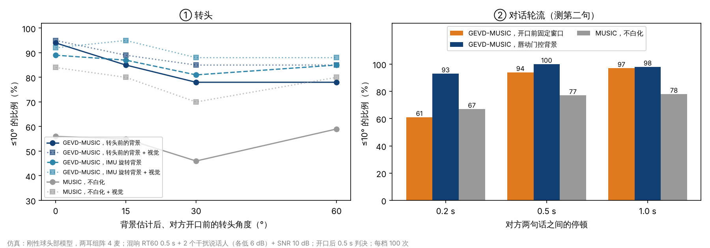
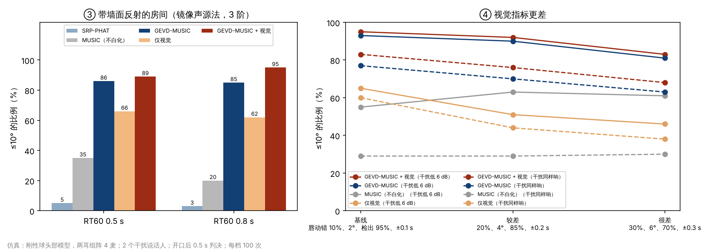

# 稳健性验证（T4b）：转头、对话轮流、墙面反射、视觉更差

> 2026-11-18。代码 `code/earbud_ssl/scripts/run_robustness.py`，原始结果 `code/earbud_ssl/out/robust_*`。
> 数字均为**仿真结果**；解读部分标【判断】。
> 四项风险全部完成：① 转头、② 对话轮流、③ 带墙面反射的房间、④ 视觉指标更差。

## 1. 结论

- **初选的 GEVD-MUSIC（背景白化）+ 软融合通过全部四项，选型定稿**（仿真范围内）：四项风险都会让精度下降，但在每种设置下，它都明显优于不白化的 MUSIC 和 SRP-PHAT，加视觉后也从未低于纯声学。
- **背景估计必须用"唇动门控"**，这是新增的必选环节：只用"对方嘴闭上超过 0.2 s"的帧递推更新背景。对方两句话之间停顿很短时，固定窗口会把上一句混进背景，准确率掉到 61%；唇动门控后为 93%。
- **转头会让背景过时**：背景估计后、对方开口前转头 30–60° 时，准确率从 94% 降到 78%。下降有限，不必换方法。
- **带墙面反射的房间**（早期反射与直达声能量相当）：GEVD-MUSIC 85–86%，加视觉 89–95%；SRP-PHAT 只有 3–5%，不白化的 MUSIC 20–35%。
- **视觉指标变差时平稳下降，没有崩溃**：唇动错误 30%、方位误差 6°、检出 70%、开口时刻误差 ±0.3 s 时，GEVD-MUSIC + 视觉为 68–83%（基线 83–95%）；仅视觉则降到 38–46%。
- **IMU 旋转背景的收益不稳定**：转头 ≥ 15° 时提高 2–7 个百分点（多在统计误差量级），不转头时反而降 5 个百分点。不作为必选，最多在转头超过约 10° 时启用；更好的办法待研究【判断】。

## 2. 共同设置

| 项目 | 设置 |
|---|---|
| 阵列 | 两耳组阵，4 麦，刚性球头部模型；5° 网格 + 抛物线细化 |
| 条件 | 混响 RT60 0.5 s、直达混响比 0 dB、SNR 10 dB；2 个干扰说话人全程说话（各比目标低 6 dB） |
| 判决 | 对方开口后 0.5 s；开口时刻由唇动给出（±0.1 s 误差） |
| 视觉 | 与算法选型相同（检出率 95%、方位误差 2°、唇动错误 10%，视野内 1 个不说话的旁人）；软融合 λ = 0.1、μ = 0.05 |
| 次数 | 每档 100 次（种子 11，与选型、调参的种子都不同） |

## 3. ① 转头

**设置**：先在头朝 0° 时估计背景；对方开口前 0.08 s，用户转头 Δ（0°、15°、30°、60°），之后的判决在新朝向下进行。目标在转头后的头部前方 ±60° 内。这是最坏的情况：转头后没有时间重新估计背景。

**比较**：
- GEVD-MUSIC，直接用转头前的背景；
- GEVD-MUSIC + IMU 旋转背景：从背景协方差估出 3 个干扰方向，逐频点拟合"干扰 + 扩散噪声"模型，再按 IMU 测得的转角（误差 2°）平移干扰方向，重建背景；
- MUSIC，不白化。

| 转头 | GEVD 转头前背景 | + 视觉 | GEVD IMU 旋转背景 | + 视觉 | MUSIC 不白化 | + 视觉 |
|---|---|---|---|---|---|---|
| 0° | **94%** | **95%** | 89% | 92% | 56% | 84% |
| 15° | 85% | 89% | **87%** | **95%** | 55% | 80% |
| 30° | 78% | 85% | **81%** | **88%** | 46% | 70% |
| 60° | 78% | 85% | **85%** | **88%** | 59% | 80% |

## 4. ② 对话轮流

**设置**：对方先说一句（1 s），停顿 0.2 / 0.5 / 1.0 s 后说第二句；测第二句的方向。干扰说话人全程说话。头不动。

**比较**：
- GEVD-MUSIC，背景取开口前固定 0.35 s 的窗口（留 0.15 s 间隔）；
- GEVD-MUSIC，唇动门控背景：只用"嘴闭上超过 0.2 s"的帧，按 1 s 时间常数指数遗忘；
- MUSIC，不白化。

| 停顿 | GEVD 固定窗口 | + 视觉 | GEVD 唇动门控 | + 视觉 | MUSIC 不白化 | + 视觉 |
|---|---|---|---|---|---|---|
| 0.2 s | 61% | 72% | **93%** | **95%** | 67% | 81% |
| 0.5 s | 94% | 95% | **100%** | **99%** | 77% | 92% |
| 1.0 s | 97% | 99% | **98%** | **99%** | 78% | 92% |

## 5. ③ 带墙面反射的房间

**设置**：随机鞋盒房间，6–10 × 5–8 × 2.8–3.5 m（约 84–280 m³，餐厅、咖啡馆量级）；墙面吸声按 Sabine 公式由 RT60 反推。用户坐姿（头高 1.2 m），离墙 ≥ 1.2 m，朝向随机。早期反射用镜像声源法算到 3 阶，每条反射按它的来向经过刚性球头部模型（方位 5°、仰角 15° 查表）；更晚的混响用扩散尾补足，总的混响能量按 Sabine 临界距离设定。2 个干扰说话人同样经过房间。早期反射与直达声的能量比中位数为 −0.9 dB（RT60 0.5 s）、+0.1 dB（RT60 0.8 s），即墙面反射和直达声差不多强。SNR 分别为 10 dB、5 dB。

| RT60 | SRP-PHAT | MUSIC 不白化 | **GEVD-MUSIC** | 仅视觉 | MUSIC + 视觉 | **GEVD-MUSIC + 视觉** |
|---|---|---|---|---|---|---|
| 0.5 s | 5% | 35% | **86%** | 66% | 65% | **89%** |
| 0.8 s | 3% | 20% | **85%** | 62% | 65% | **95%** |

## 6. ④ 视觉指标更差

**设置**：算法选型的 S2（干扰低 6 dB）、S4（干扰同样响）两个条件，视觉分三档。开口时刻误差同时影响判决窗和背景段的位置。

| 档位 | 唇动错误率 | 人脸方位误差 | 检出率 | 开口时刻误差 |
|---|---|---|---|---|
| 基线 | 10% | 2° | 95% | ±0.1 s |
| 较差 | 20% | 4° | 85% | ±0.2 s |
| 很差 | 30% | 6° | 70% | ±0.3 s |

| 条件 / 档位 | GEVD-MUSIC | **GEVD-MUSIC + 视觉** | MUSIC 不白化 | MUSIC + 视觉 | 仅视觉 |
|---|---|---|---|---|---|
| 干扰低 6 dB / 基线 | 93% | **95%** | 55% | 79% | 65% |
| 干扰低 6 dB / 较差 | 90% | **92%** | 63% | 73% | 51% |
| 干扰低 6 dB / 很差 | 81% | **83%** | 61% | 67% | 46% |
| 干扰同样响 / 基线 | 77% | **83%** | 29% | 51% | 60% |
| 干扰同样响 / 较差 | 70% | **76%** | 29% | 41% | 44% |
| 干扰同样响 / 很差 | 63% | **68%** | 30% | 36% | 38% |

## 7. 解读【判断】

1. **唇动门控是音视频协同的第二个具体落点。** 第一个是"唇动给出开口时刻"；第二个是"唇动决定哪些帧可以拿来估计背景"。没有视觉的话，只能靠声学检测谁在说话，正是在多人说话时最不可靠的环节。
2. **转头的影响小于预期。** 干扰说话人在头部坐标下移动了 Δ，但在混响和扩散噪声中，背景协方差里有相当一部分来自扩散成分，与方向无关；过时的背景仍能白化掉其中大部分。
3. **IMU 旋转背景的瓶颈是"把背景拆成几个方向 + 扩散"这一步的近似误差**：不转头时它也会引入误差，所以 0° 时反而变差。更稳的办法可能是：转头后用唇动门控尽快重新累积背景，转头幅度大时临时降低白化强度。待研究。
4. **视觉在四项里都有稳定增益**，从未让结果变差（软融合保留了声学候选）。
5. **墙面反射不改变结论。** 早期反射有确定方向，但它和直达声在时间上分得开，起始段加权给了直达声更大的权重；背景白化又去掉了干扰说话人的反射。SRP-PHAT 在这种房间里几乎失效（3–5%），说明"换掉 SRP-PHAT"这个决定是必要的。
6. **方案对视觉质量是"平稳退化"。** 即使视觉很差，GEVD-MUSIC 仍比不白化的 MUSIC 高 20–30 个百分点，说明唇动给出的开口时刻即使误差 ±0.3 s 也够用。视觉越差，"仅视觉"下降越快（65% → 46%），这时声学是主体、视觉是辅助的分工就更重要，和《技术洞察》的定位一致。

## 8. 局限

- 转头设成瞬间完成、发生在开口前 0.08 s；没有模拟转头过程中的测向，也没有模拟头部持续小幅晃动。
- 干扰说话人全程说话，背景是平稳的；干扰人与目标同时开口的情况没有测。
- 镜像声源房间只到 3 阶，墙面吸声与频率无关，没有家具和人体的遮挡与散射；头部传递函数表按 5° / 15° 取最近邻。
- 其余局限同 `算法选型.md`（刚性球头部模型、视觉为假设）。结论需用实测头部传递函数和真实视觉指标复核。

## 9. 对技术方案的影响

- 背景估计：改为"唇动门控 + 递推更新"（嘴闭上超过 0.2 s 的帧，时间常数约 1 s），写入融合流程和协同机制。
- 转头：记录为已知影响（最坏情况约 −16 个百分点）；IMU 旋转背景列为可选模块，待改进。
- 四项通过，算法选型定稿（仿真范围内）：GEVD-MUSIC（唇动门控背景白化）+ 起始段加权 + 头部模板 + 5° 网格 + 软融合。
