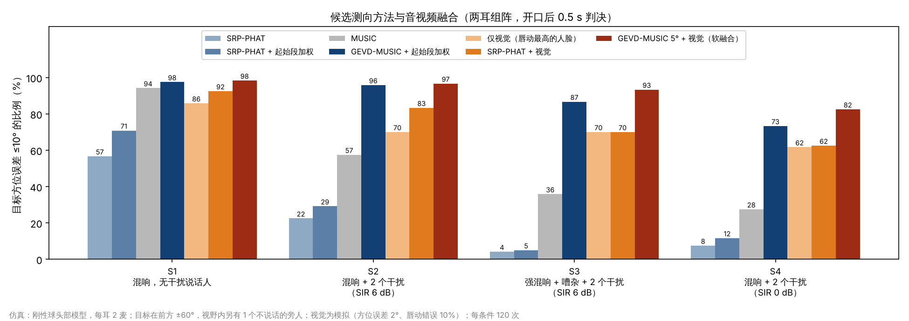

# 算法选型（T4）：耳机端声源定位

> 2026-11-18。代码 `code/earbud_ssl/`（`scripts/run_algo_selection.py`），原始结果 `code/earbud_ssl/out/algo_selection_*`。
> 数字均为**仿真结果**；计算量、内存为**估算**；解读部分标【判断】。

## 1. 结论

**选用：GEVD-MUSIC（背景白化）+ 起始段加权 + 含头部影响的方向模板 + 5° 网格，再与视觉人脸做软融合。**

- 属于《技术洞察》要求的经典信号处理路线，不需要训练数据。
- 把《技术洞察》第 5 页写的 SRP-PHAT 换成 GEVD-MUSIC：有干扰说话人时，SRP-PHAT 的准确率只有 4–29%，GEVD-MUSIC 有 73–97%。
- **音视频协同点**：唇动给出对方的开口时刻；开口前的一段（只有干扰和噪声）用来估计背景，然后把背景白化掉。也就是说，视觉不只是在最后校正方向，还直接参与声学测向。
- 估算计算量约 12 MFLOPS，模板约 120–250 KB，与《技术洞察》"现有耳机 ANC 芯片量级"的设定相符【判断，需在目标芯片上实测】。

## 2. 实验设置

| 项目 | 设置 |
|---|---|
| 阵列 | 两耳组阵，每耳 2 麦（共 4 麦），两耳同步；刚性球头部模型 |
| 目标 | 前方 ±60° 内，距离 1–2 m；开口前 0.5 s 不说话，之后说 1 s |
| 干扰 | 2 个干扰说话人全程说话，任意方位（与其他人相隔 ≥ 20°），1.5–3 m |
| 视觉（模拟） | 视野 ±70°，检出率 95%，人脸方位误差 σ = 2°，唇动判断错误率 10%；视野内另有 1 个不说话的旁人 |
| 开口时刻 | 由唇动给出，含 ±0.1 s 误差；判决窗为开口后 0.5 s；背景段为开口前（留 0.15 s 间隔） |
| 条件 | S1 混响（RT60 0.5 s，直达混响比 0 dB，SNR 10 dB），无干扰说话人；S2 = S1 + 2 个干扰（各比目标低 6 dB）；S3 强混响（RT60 0.8 s，−3 dB，SNR 5 dB）+ 2 个干扰（低 6 dB）；S4 = S1 + 2 个干扰（与目标一样响） |
| 次数 | 每个条件 120 次（评测种子 1） |
| 调参 | 软融合的 λ、μ 在开发种子 7 上调过（`scripts/tune_fusion.py`），其余参数沿用场景一或事先设定；都没有在评测数据上调参 |

## 3. 结果

目标方位误差 ≤ 10° 的比例：

| 方法 | S1 混响 | S2 + 干扰 | S3 强混响 + 干扰 | S4 干扰同样响 |
|---|---|---|---|---|
| SRP-PHAT | 57% | 23% | 4% | 8% |
| SRP-PHAT 5° 网格 | 54% | 23% | 4% | 8% |
| SRP-PHAT + 起始段加权 | 71% | 29% | 5% | 12% |
| MUSIC | 94% | 58% | 36% | 28% |
| GEVD-MUSIC + 起始段加权 | 98% | 96% | 87% | 73% |
| **GEVD-MUSIC 5° 网格** | **98%** | **97%** | **87%** | **73%** |
| 仅视觉（唇动最高的人脸） | 86% | 70% | 70% | 62% |
| SRP-PHAT + 视觉（硬规则） | 92% | 83% | 70% | 62% |
| GEVD-MUSIC + 视觉（硬规则） | 98% | 91% | 87% | 83% |
| **GEVD-MUSIC 5° + 视觉（软融合）** | **98%** | **97%** | **93%** | **82%** |

## 4. 发现

1. **背景白化是关键。** 同样是 MUSIC，用开口前的背景白化后，S2 从 58% 升到 96%，S4 从 28% 升到 73%。这和场景一的结论一致（`记录/阶段小结/2026-11-16_会议室测向仿真小结.md`）。
2. **SRP-PHAT 在混响和干扰下不适用。** 即使加了起始段加权，有干扰时也只有 5–29%【判断：PHAT 丢掉了幅度信息，而头部遮挡带来的耳间电平差正是 MUSIC 能用上的线索】。
3. **5° 网格加抛物线细化与 1° 网格精度相同**，扫描计算量和模板内存降到 1/5。
4. **视觉单独用不够**：视野里常有多个人在说话，加上唇动误判，只靠视觉选人只有 62–86%。
5. **融合规则要"软"**。只在"唇动分数高"的人脸里选（硬规则），目标唇动被误判时会被排除，S2 反而从 96% 降到 91%。改成"声学谱值 + 唇动加分，并保留声学峰值作为候选"后，四个条件都不低于纯声学，S3 提高 6 个百分点，S4 提高 9 个百分点。

## 5. 计算量与内存（估算）

按 16 kHz、512 点帧、帧移 256（每秒 62.5 帧）、200–7000 Hz 共 218 个频点、4 麦、每秒判决 4 次估算：

| 方法 | 每秒浮点运算 | 方向模板（复数半精度） | 其他状态 |
|---|---|---|---|
| SRP-PHAT 1° | 约 18 M | 约 1.2 MB | — |
| SRP-PHAT 5° | 约 6 M | 约 245 KB | — |
| GEVD-MUSIC 1° | 约 47 M | 约 1.2 MB | 协方差约 54 KB |
| **GEVD-MUSIC 5°（选用）** | **约 12 M** | **约 245 KB；利用左右对称存一半约 123 KB** | 协方差约 54 KB |

- Python 每次判决耗时（相对比较）：GEVD-MUSIC 5° 约 3 ms，1° 约 8.5 ms。
- 进一步降算力的方向【判断】：
  - 有视觉人脸时，只扫描人脸附近 ±10°，扫描量可再降一个数量级；
  - 隔一个频点取一个，模板和计算都减半；
  - 背景协方差按"唇动关闭时"递推更新，不需要缓存音频。
- 微型神经网络（参数 < 0.1 M）留作对照，等有匹配场景的训练数据后再比较。

## 6. 局限

- 头部模型是刚性球，没有耳廓；混响为"多方向随机衰减"近似，不是房间几何仿真。需用实测头部传递函数复核。
- 头部不动；转头时的 IMU 补偿还没有加进仿真。
- 视觉是按假设模拟的，真实指标要等视觉同事给出。
- 背景段假设"对方开口前，干扰和噪声已经存在"。如果干扰人与目标同时开口，白化的作用会减弱。
- 每个条件 120 次，比例的统计误差约 ±4 个百分点。

## 7. 对技术方案的影响

- D7（定位算法）：定为 GEVD-MUSIC（背景白化）+ 起始段加权 + 头部模板 + 5° 网格。
- D6（融合方式）：软融合；唇动同时用于"给出开口时刻、划分背景段"。
- 12 月仿真在此基础上加入：转头（IMU 补偿）、说话人移动、实测头部传递函数复核。
